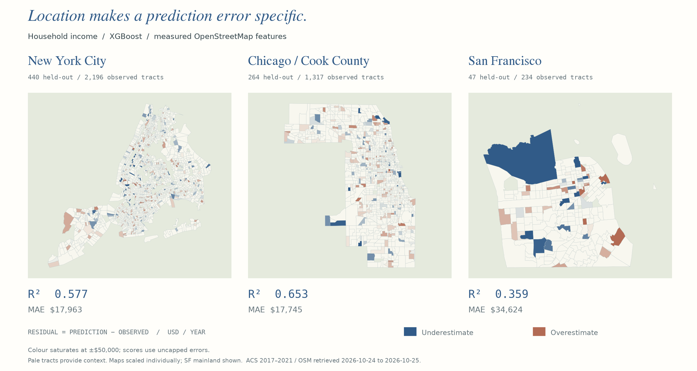
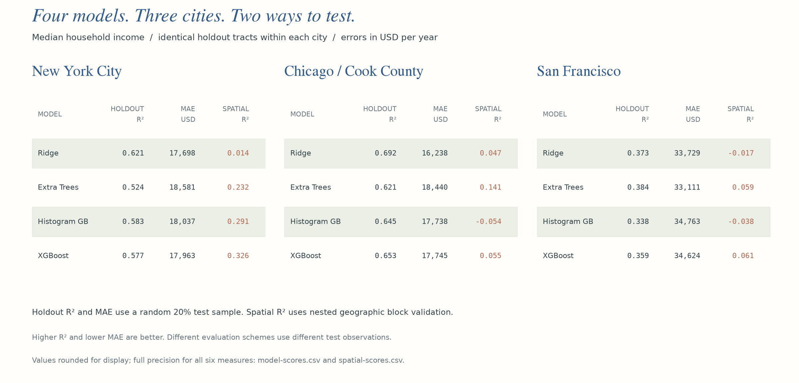
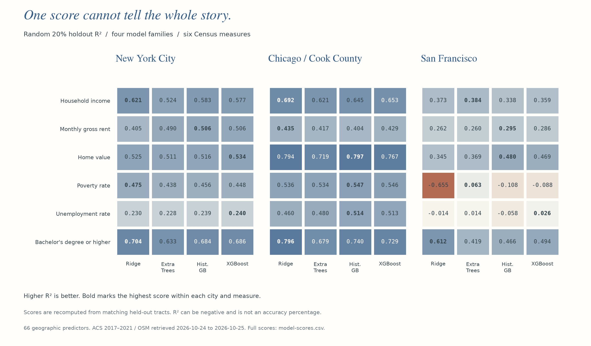
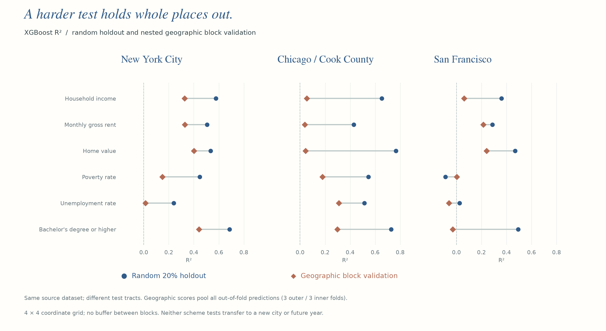
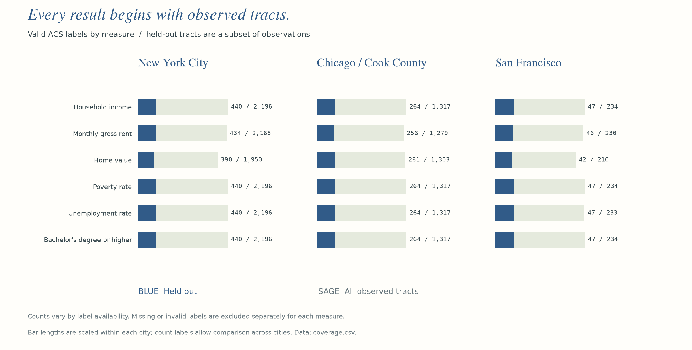
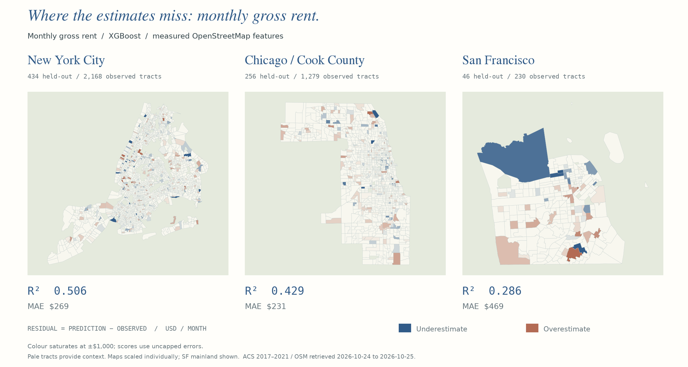
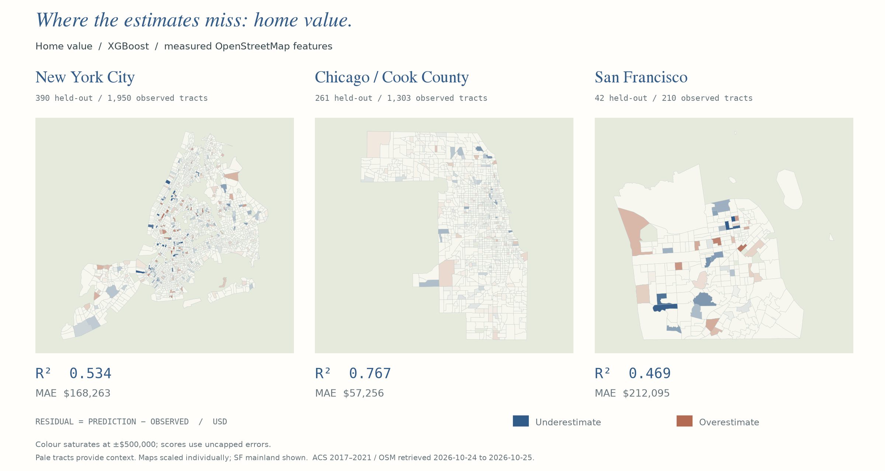
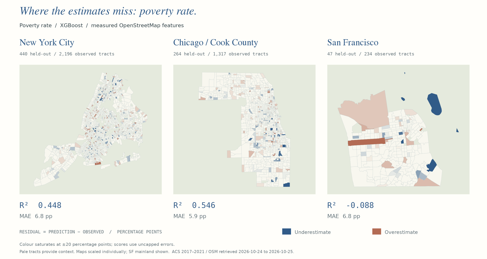
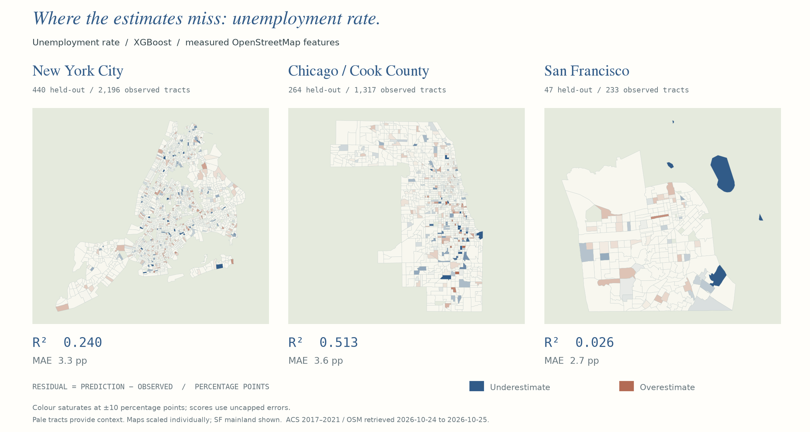
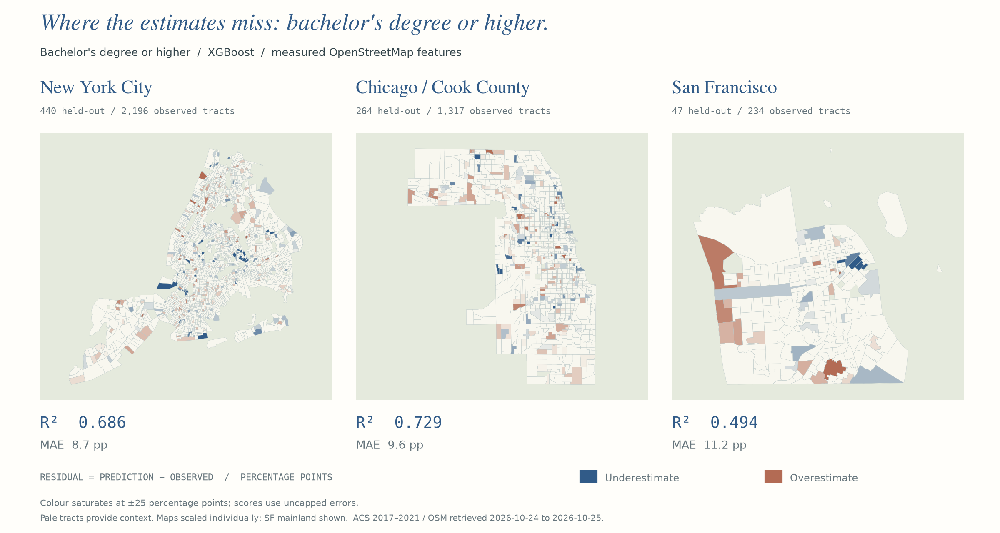

# TerraLens

**Neighborhood estimates, made visible.**

TerraLens combines US Census indicators with measured OpenStreetMap features to estimate six socioeconomic measures across New York City, Chicago / Cook County, and San Francisco. Explore tract-level predictions, see where models miss, and compare four regression models in an interactive Streamlit dashboard.



*Location makes a prediction error specific. Colored tracts show errors on held-out observations; pale tracts provide geographic context. Each map is scaled individually.*

## What you can explore

- **Maps:** switch between predicted values, published observations, and prediction errors.
- **Quick check:** compare the selected model with a training-mean baseline on the same test tracts.
- **Model comparisons:** inspect R², MAE, and RMSE, then compare two models' predictions on matching tracts and download the paired values.
- **Six measures:** median household income, median monthly gross rent, median home value, poverty rate, unemployment rate, and the share of adults with a bachelor's degree or higher.
- **Four models:** Ridge Regression, Extra Trees, Histogram Gradient Boosting, and XGBoost.

The sidebar model controls Map and Quick check. Compare includes all available models for the selected city and measure, using only shared observed tracts. Available choices follow the prediction files present on your machine.

## Results

These figures summarize saved OSM-only predictions using **2021 ACS labels and OSM extracts retrieved on 24–25 October 2026**. They are static snapshots; the dashboard reads your local results. The maps use XGBoost predictions from a random 20% holdout. Monetary errors use US dollars per year for income, dollars per month for rent, and dollars for home value. Rate errors are shown in percentage points. Each measure uses its own color scale.

### Compare models



*The income results tables, shown together in a single figure. Holdout and spatial validation use different test observations.*



*Higher R² indicates better fit relative to the observed-value mean. R² is not an accuracy percentage and can be negative. Model scores are calculated on matching test observations.*

### Check geographic generalization



*Geographic validation holds entire coordinate-grid cells out of training. It evaluates a different question from a random tract split; neither establishes transfer to another city or future year.*

### Understand the data coverage



*Coverage depends on the measure. Missing rent or home-value labels reduce the available observations; context polygons in the maps are not additional test predictions.*

<details>
<summary>Maps for every measure</summary>

Residual = prediction − published observation. Blue means the estimate is too low; terracotta means it is too high. Scales and units are printed on each figure.

### Median monthly gross rent



### Median home value



### Poverty rate



### Unemployment rate



### Bachelor's degree or higher



</details>

Full numerical results, tract counts, and source metadata are stored in `docs/assets/`. To regenerate the figures from prepared local results, run:

```bash
python scripts/make_readme_figures.py
```

## Get started

Requires **Python 3.10 or newer**. From a terminal in the project folder:

```bash
python3 -m venv .venv
source .venv/bin/activate
python -m pip install -r requirements.txt
python -m streamlit run app.py
```

## Project layout

```text
app.py                       Streamlit dashboard
terralens/                   Shared data, evaluation, UI, and utilities
scripts/                     Data preparation, prediction caching, and visualizations
experiments/                 Training and experiment runners
configs/                     City and training settings
docs/assets/                 Versioned README figures
docs/maps/                   Local interactive map exports (generated)
data/                        Local source data and processed datasets (generated)
outputs/preds/               Local prediction cache (generated)
outputs/spatial_validation/  Local geographic validation reports (generated)
tests/                       Regression checks with synthetic fixtures
```

## Development

The install above includes development tools. Run:

```bash
make lint
make test
```

Tests cover dashboard loading and controls, matched model comparisons, training/test separation, geographic validation, data preparation, and map exports. They use small synthetic fixtures and mocked downloads, so no API key or city-data download is required. Optional historical map-export checks skip when their local files are absent.

## Data and license

Created by **Saatvik Rai**. Code is released under the MIT License.

Data sources have their own terms: OpenStreetMap contributors (ODbL), US Census American Community Survey (public domain), and optional NYC Open Data 311 records.
